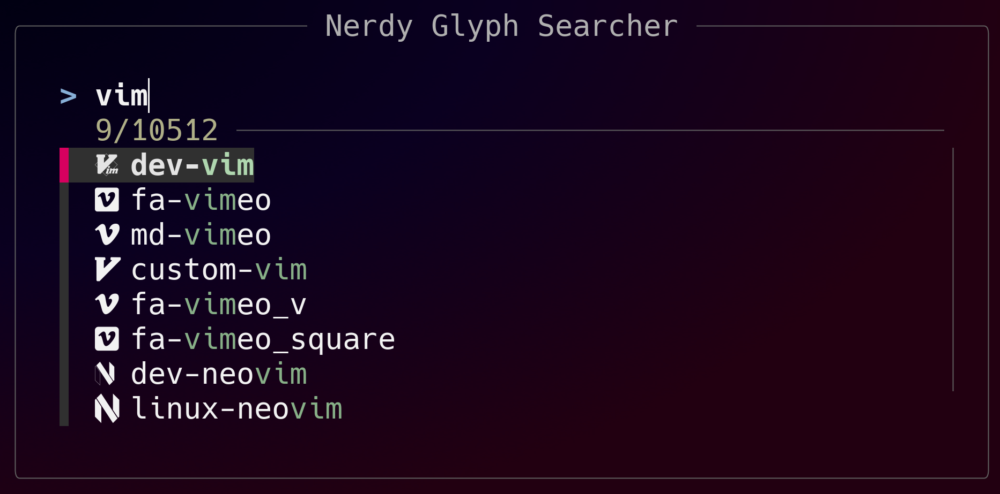

# Nerdy Glyph Searcher

Search through [nerd font](https://www.nerdfonts.com/) glyphs in the terminal.



_Screenshot of interactive search_

## Requirements

Fonts must be `.ttf`.

### Terminal

Any terminal should work as long as the font file specified matches the one
used by the terminal.

Auto-Detection Supported Terminals:

* WezTerm
* Ghostty

### Runtime Dependencies

* `fzf` for interactive searching
* `fc-match` from `fontconfig` for Ghostty

## Usage

The program can auto-detect the font file to use.

```sh
nerdy_glyph_searcher
```

Manually specify the font file to use.

```sh
nerdy_glyph_searcher -f /usr/share/fonts/truetype/NerdFonts/Hack/HackNerdFontMono-Regular.ttf
```

Send the output to stdout instead of interactive mode.

```sh
nerdy_glyph_searcher -o | grep "vim"
```

OR

```sh
nerdy_glyph_searcher -o | fzf --layout=default
```

## License

Nerdy Glyph Searcher

Copyright (C) 2026 Tanner Weber

This program is free software: you can redistribute it and/or modify
it under the terms of the GNU Affero General Public License as published by
the Free Software Foundation, either version 3 of the License, or
(at your option) any later version.

This program is distributed in the hope that it will be useful,
but WITHOUT ANY WARRANTY; without even the implied warranty of
MERCHANTABILITY or FITNESS FOR A PARTICULAR PURPOSE.  See the
GNU Affero General Public License for more details.

You should have received a copy of the GNU Affero General Public License
along with this program.  If not, see <https://www.gnu.org/licenses/>.
